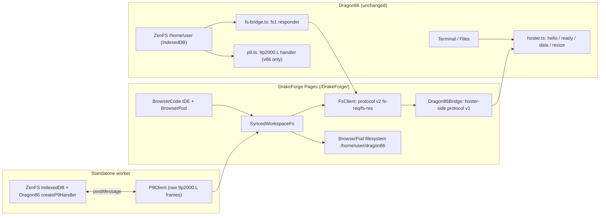

# Architecture

## Repositories and trust boundaries



## Connected protocol

DrakeForge copies the Cheerpx-Bridge wire contract rather than inventing a new one:

```
Dragon86 → DrakeForge  { v:1, t:"hello", caps:["fs1"] }         repeated until ready
DrakeForge → Dragon86  { v:1, t:"ready", caps:["fs1"] }         after BrowserPod shell is live
Dragon86 → DrakeForge  { v:1, t:"data", d:string }              terminal keystrokes
Dragon86 → DrakeForge  { v:1, t:"resize", cols, rows }
DrakeForge → Dragon86  { v:1, t:"data", d:string }              shell output, batched ~16 ms
DrakeForge → Dragon86  { v:1, t:"exit", code }

DrakeForge → Dragon86  { v:2, t:"fs-req", id, op, path?, to?, data? }
Dragon86 → DrakeForge  { v:2, t:"fs-res", id, ok, error?, entries?, tree?, data?, stat? }
```

`ops` are `list | tree | read | write | mkdir | remove | rename | stat`. Paths are relative to Dragon86's share root. `read`/`write` are whole-file and capped at 16 MB; `tree` is capped at 5,000 entries.

Two transports are always attached behind one `CompositeTransport`:

- `PostMessageTransport` for a hidden-iframe/embedded hoster. It accepts messages only from `window.parent`, and only from the same origin, `https://dragon-gaming-platforms.github.io`, localhost, or Arena preview origins. Replies go to the exact origin that said `hello`, never `*`.
- `BroadcastChannelTransport` on `dragon86-hoster-v1` for separate-tab mode. Hoster-originated channel messages carry `via: "bc-hoster"` so a second hoster tab ignores them. BroadcastChannel is same-origin by construction.

The `ready` capability `fs1` is advertised only after `remote.tree()` has answered successfully; `Dragon86Bridge.setFsLive(true)` calls `refreshReady()` to re-announce it if the terminal handshake finished earlier.

## Why this is not a 9p mount

Dragon86's `p9.ts` returns `(request: Uint8Array, reply: (Uint8Array) => void) => void`. v86 passes it as `filesystem.handle9p`; there is no socket, URL, or cross-window listener. Cheerpx cannot accept a 9p device either, which is why Dragon86's `fs-bridge.ts` exists.

BrowserPod exposes only `openFile`, `createFile`, `createDirectory`, `run`, and terminal APIs. It has no public mount hook. A BrowserCode `WorkspaceFs` adapter can make the _editor_ use a remote filesystem, but BrowserPod's bash and dev server would still read their own block-based VFS. `SyncedWorkspaceFs` therefore keeps a pod-side copy and reconciles it with the remote tree.

## Sync algorithm

State per remote-relative path: `{ isDir, size, mtime, hash? }`.

- **Boot:** `remote.tree()` → `beginHydrate()` → write every file into PodFs → set the baseline → `start()`.
- **Local write:** PodFs write → remote `write`/`mkdir`/`rename`/`remove` → mark `pendingLocal[path] = hash(bytes)` → update baseline from the returned stat.
- **Poll (2 s):** `remote.tree()` → compare `(isDir,size,mtime)` to baseline.
  - New/changed remote path and no matching pending-local hash: read remote bytes and write into PodFs.
  - Remote deletion and no pending-local entry: delete from PodFs.
  - Pending-local path whose remote content hash matches: clear pending and keep the baseline.
  - Conflicting remote change: remote wins; pull it and drop the pending marker.
- The UI's `projectFiles` and `projectDirs` are refreshed from the same snapshot through an optional `watchFiles` hook added to `ProjectSource`.

The sync layer is deliberately conservative: it never deletes local files merely because a remote request failed, and it ignores paths outside the IDE workdir (for example BrowserPod's `.bp_rc`).

## Standalone 9p worker

`WorkerP9Transport` posts exact 9p frames to a module Worker. The Worker configures ZenFS (`/home` on IndexedDB, `/tmp` in memory), seeds a default project if empty, and calls Dragon86's `createP9Handler(root)`. Each response is copied into a transferable `ArrayBuffer`. `P9Client` implements the 9p2000.L subset needed by `P9RemoteFs`: `Tversion`, `Tattach`, `Twalk`, `Tlopen`, `Tlcreate`, `Tread`, `Twrite`, `Treaddir`, `Tgetattr`, `Tmkdir`, `Tunlinkat`, `Trenameat`, and `Tclunk`, plus `Rlerror` handling. Recursive removal is done with repeated `Tunlinkat` calls, including `AT_REMOVEDIR` for directories.

`tools/p9/test.ts` runs the real server and client over an in-process loopback with ZenFS `InMemory`, exercising the wire format without a browser.

## UI shell

DrakeForge is now a **single workspace entry point**. `src/routes/+page.svelte` opens the connected workspace; `/dragon86` and `/standalone` are mode aliases; `/agents`, `/agents/[tool]`, `/ide`, and `/embed` redirect back into it. `src/routes/+layout.svelte` removes BrowserCode's sidebar, ribbon, tour, announcement bar, and utility bar, and imports the global Dragon86 theme.

The layout is modeled on VS Code and Dragon86's real `src/styles/theme.css` / `src/styles/os.css` (upstream `e30b868`). Exact Dragon Red hex codes, glow shadows, uppercase `Orbitron`-style headings, `Rajdhani`-style body text, scrollbar treatment, radial desktop gradients, and the `#e60012 → #4a0000` status-bar gradient come from that stylesheet. `src/lib/dragon86/theme.css` maps those tokens onto BrowserCode's `--color-bc-*` variables so Monaco, xterm, file tree, and portals all inherit the Dragon86 palette.

The **Agents** activity view is inline: `AgentsPanel.svelte` constructs an `AgentSession` and renders `AgentShell` in the side bar. `src/lib/agents/session.svelte.ts` gained an optional `onRestart` hook so changing a credential relaunches only that inline CLI session instead of reloading the whole workspace tab. `GitPanel.svelte` runs real git commands in the Output terminal. The bottom panel has VS Code-style Problems/Output/Debug Console/Terminal/Ports tabs; the terminal stays mounted and spans the full workspace width. See `docs/link-to-dragon86.md` for the connection explanation.

## Implementation map

- `src/routes/+page.svelte` and `src/lib/dragon86/components/Workspace.svelte` — one browser tab per workspace; owns the Dragon86/9p source and `IdeSession`.
- `src/routes/+layout.svelte` and `src/lib/dragon86/theme.css` — global VS Code/Dragon86 chrome and exact Dragon Red tokens.
- `src/lib/dragon86/components/Dragon86IdeShell.svelte` — title/menu bar, activity bar, side bar, editor group, preview group, bottom panel, and status bar.
- `src/lib/dragon86/components/AgentsPanel.svelte` — inline agent CLI runner; `GitPanel.svelte` — Source Control actions.
- `src/lib/dragon86/bridge/` — Cheerpx-Bridge-derived v1/v2 protocol, transports, hoster handshake, fs1 client, and the BrowserPod-backed `Dragon86Bridge`.
- `src/lib/dragon86/fs/` — `RemoteFs` interface, fs1 and 9p implementations, `SyncedWorkspaceFs`, and the `ProjectSource` adapter.
- `src/lib/dragon86/p9/` — copied Dragon86 9p handler, literal-frame client, Worker server, and Worker transport.
- `tools/p9/test.ts` — Node loopback integration test for the bundled 9p wire format.
- `src/lib/ide/project-source.ts`, `runtime.ts`, `session.svelte.ts`, and `pod-runtime.ts` — small optional hooks for wrapping `WorkspaceFs`, watching remote trees, and attaching a hoster after BrowserPod boots.
- Upstream `IdeShell.svelte` remains in the tree but is no longer the entry UI; old landing/agent routes redirect rather than opening a second workspace.

## GitHub Pages constraints

- Static hosting only: no TCP/WebSocket 9p listener.
- No arbitrary response headers: `coi-serviceworker.js` supplies COOP/COEP on document navigations on first visit and reloads once.
- SPA routes need `404.html`; `svelte.config.js` uses that fallback on Pages.
- `paths.base = /DrakeForge`, `paths.relative = false`, and all internal links are base-aware.
- `.nojekyll` prevents Jekyll from dropping SvelteKit's `_app/` directory.
- All cross-origin scripts without CORS/CORP opt-in were removed from the static shell.
